# AWS CloudFormation and Incident Management Projects

This repository contains two DevOps homework projects I completed while practicing AWS, Linux, infrastructure automation, and application deployment.

The first project focuses on AWS CloudFormation and GitHub Actions. The second project focuses on deploying an Incident Management application on Ubuntu EC2.

## Project 1: AWS CloudFormation and GitHub Actions

### Overview

I used AWS CloudFormation to create AWS infrastructure from YAML templates. I tested DEV and TEST environments and configured GitHub Actions to automate deployment using AWS OIDC authentication.

### Technologies

- AWS CloudFormation
- Amazon EC2 and VPC
- Ubuntu 24.04 and Nginx
- GitHub Actions
- AWS IAM and OIDC
- YAML

### What I Did

1. Created a CloudFormation template for the required AWS infrastructure.
2. Configured a VPC, public subnet, Internet Gateway, route table, and security group.
3. Launched an Ubuntu EC2 instance using CloudFormation.
4. Used EC2 User Data to install Nginx and create a test website.
5. Deployed and tested DEV and TEST environments.
6. Configured GitHub Actions to validate and deploy the CloudFormation template.
7. Used OIDC authentication to obtain temporary AWS credentials instead of storing permanent AWS access keys in GitHub.
8. Verified the deployment outputs and tested the website.
9. Updated the template and checked the deployment again.
10. Deleted the CloudFormation lab stacks after testing.

### Architecture

```text
GitHub Repository
       |
       v
GitHub Actions
       |
       v
AWS OIDC Authentication
       |
       v
AWS CloudFormation
       |
       v
VPC and Public Subnet
       |
       v
Ubuntu EC2 + Nginx
       |
       v
Web Browser
```

### Screenshots

**DEV deployment**

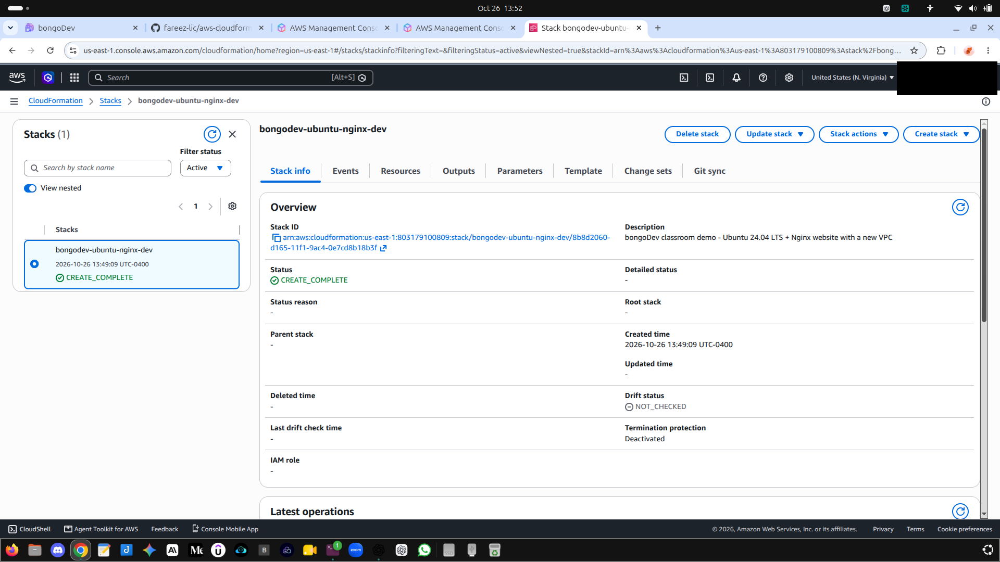

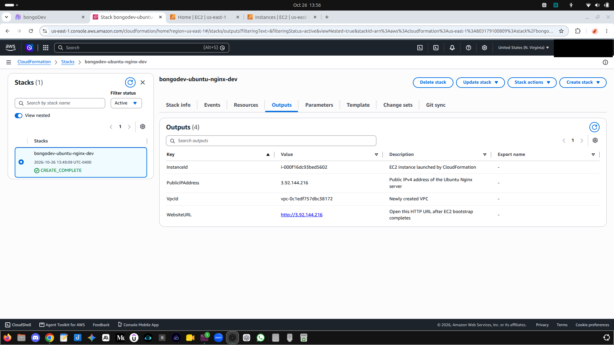

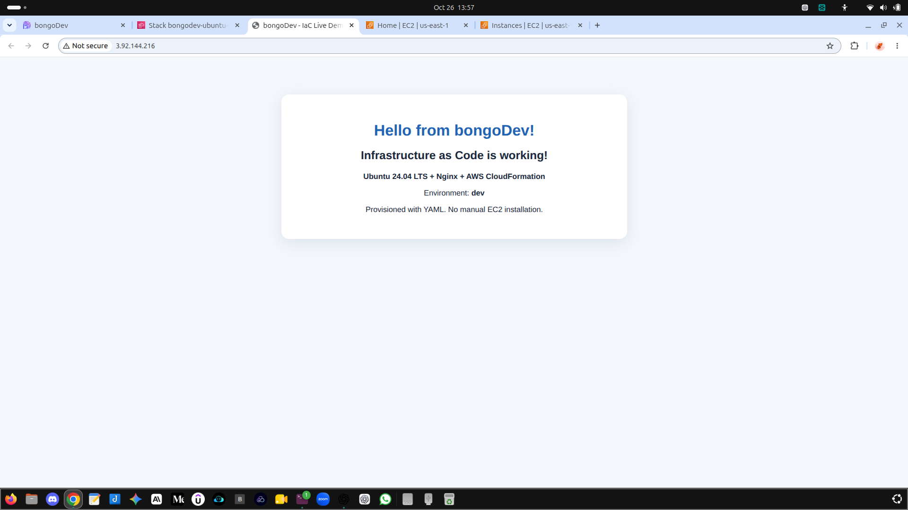

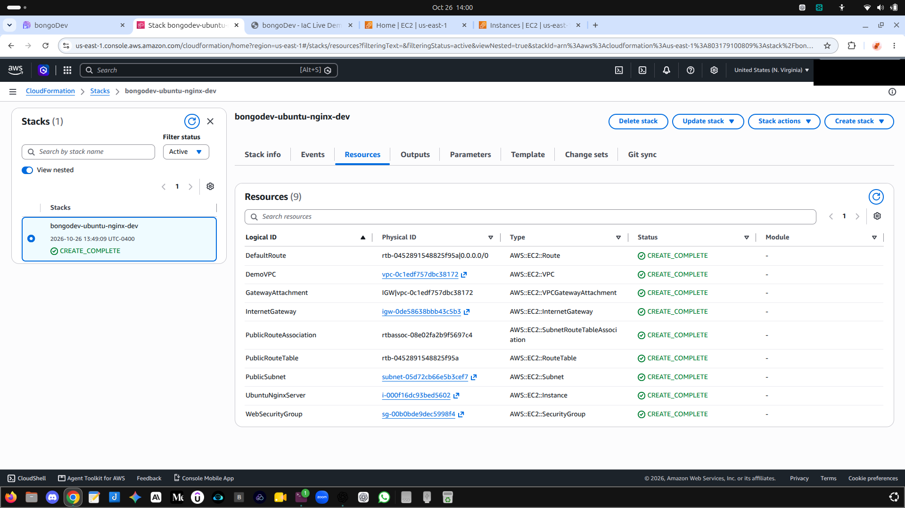

**TEST deployment**

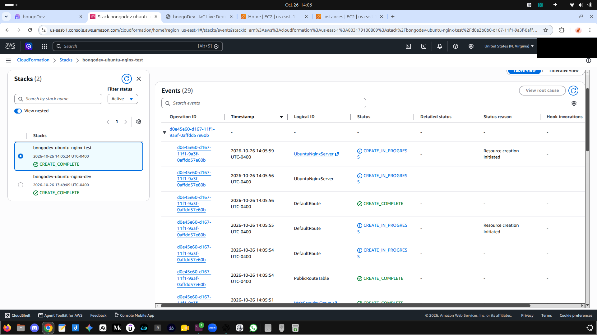

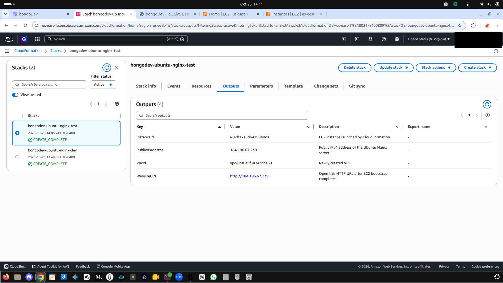

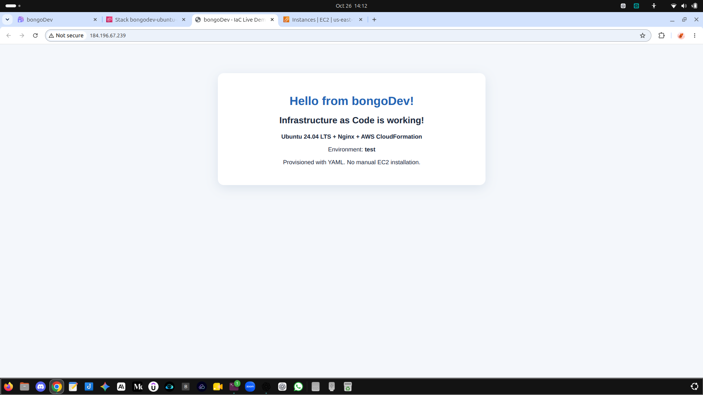

**GitHub Actions deployment**

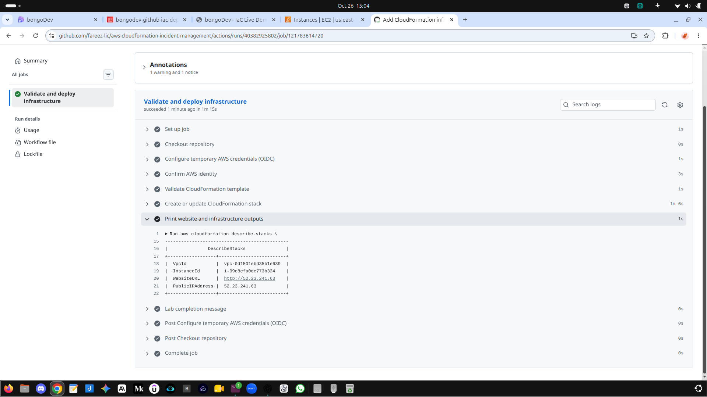

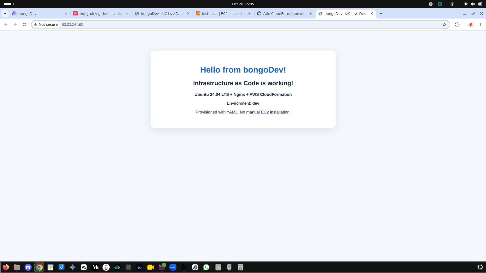

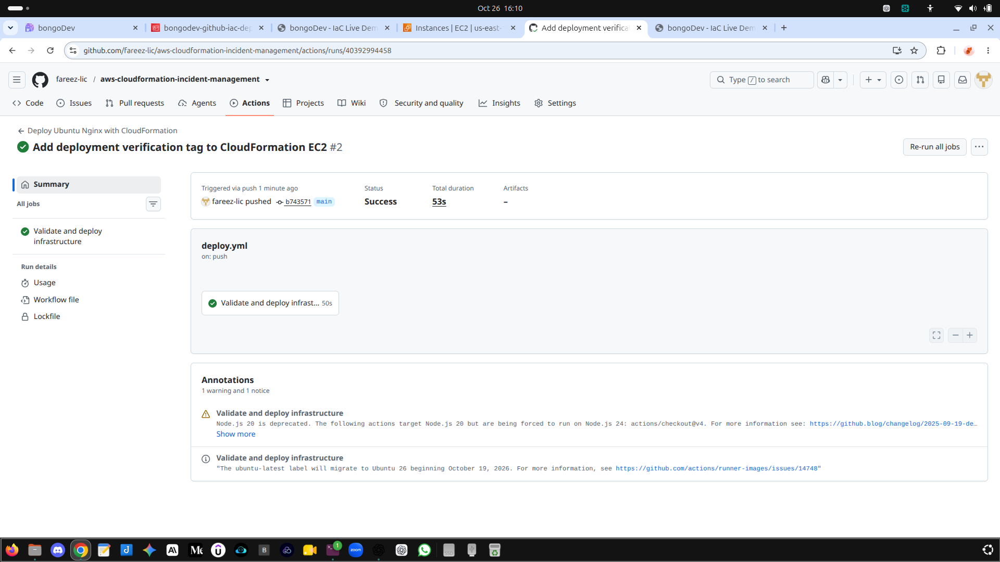

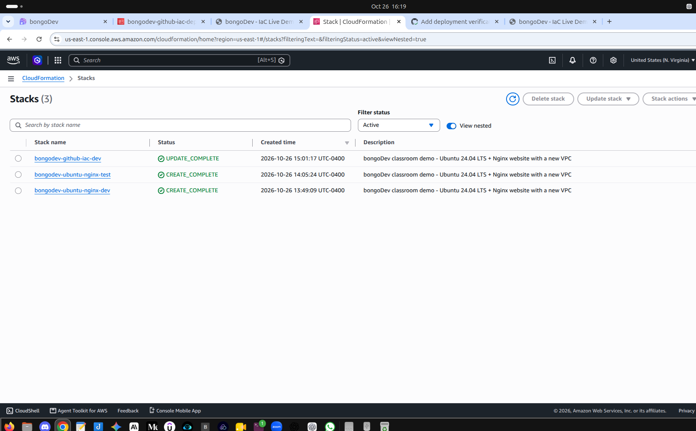

### What I Learned

I practiced Infrastructure as Code, environment-based deployments, GitHub Actions workflows, OIDC authentication, CloudFormation updates, and AWS resource cleanup.

---

## Project 2: Incident Management Application

### Overview

I deployed a full-stack Incident Management application on Ubuntu EC2.

The frontend uses React, the backend uses Node.js and Express, and PostgreSQL stores the incident data. Nginx serves the frontend and forwards API requests to the backend.

I deployed the application directly on Ubuntu without Docker.

This repository has two separate GitHub Actions workflows: one deploys the CloudFormation infrastructure lab, and one runs CI checks for the Incident Management app (backend syntax validation and frontend production build). Automated deployment of the Incident Management app to EC2 is not configured; the file `incident-management/docs/GITHUB_ACTIONS.md` is a guide for that future exercise.

The Incident Management app now has a single administrator sign-in and protects incident API endpoints with server-side sessions. See `incident-management/docs/AUTHENTICATION.md` for setup instructions and security limitations. Configure HTTPS and set `SESSION_COOKIE_SECURE=true` before any public deployment.

### Technologies

- AWS EC2
- Ubuntu 24.04
- React
- Node.js and Express
- PostgreSQL
- Nginx
- systemd
- Bash and SSH

### What I Did

1. Launched an Ubuntu EC2 instance.
2. Configured SSH access from my IP address and HTTP access on port 80.
3. Connected to the server using SSH.
4. Installed Node.js, PostgreSQL, and Nginx.
5. Configured the application database and database user.
6. Deployed the frontend and backend using Bash scripts.
7. Configured Nginx as a reverse proxy.
8. Used systemd to manage the backend service.
9. Tested incident creation and status updates in the browser.
10. Changed an incident from Open to Resolved and refreshed the page to verify the saved status.
11. Updated the frontend heading manually and redeployed the application.
12. Verified the backend health endpoint, database connection, and incidents API.
13. Checked the main services and confirmed that they were active.
14. Terminated the EC2 instance and cleaned up unused resources after testing.

### Architecture

```text
Web Browser
     |
     v
Nginx :80
   /     \
  v       v
React    /api
Frontend   |
           v
    Node.js / Express
      127.0.0.1:5000
           |
           v
       PostgreSQL
      127.0.0.1:5432
```

### Testing and Troubleshooting

I created an incident named "Database Connection Failure" with High severity and changed its status to Resolved.

I also changed the React frontend heading directly on the EC2 server. During editing, I introduced a syntax error. I corrected the code, rebuilt the frontend, and redeployed the application.

After redeployment, I confirmed that the updated heading appeared and the existing incident data was still available.

### Service Verification

I ran the project's verification scripts and checked the service status.

| Check | Result |
|---|---|
| PostgreSQL | Active |
| Nginx | Active |
| Incident backend | Active |
| Backend health endpoint | Healthy |
| Database connection | Connected |
| Incidents API | Available |

The verification script reported:

`PASS: HTML, backend health and incidents API are available.`

### Application Screenshots

**Incident created**

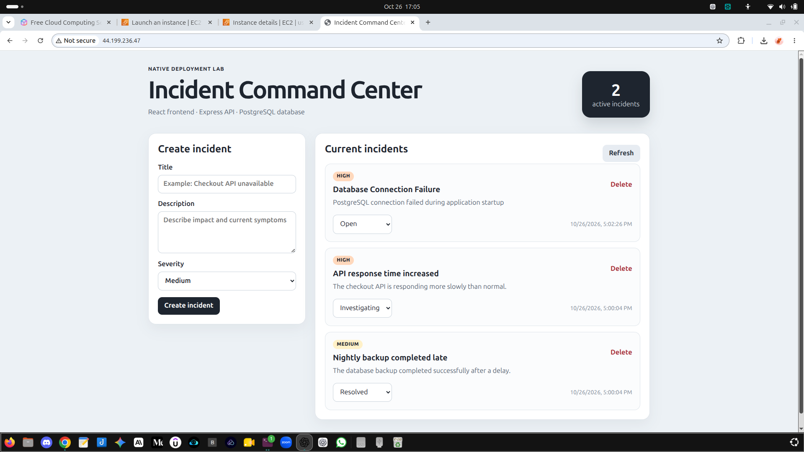

**Incident status changed to Resolved**

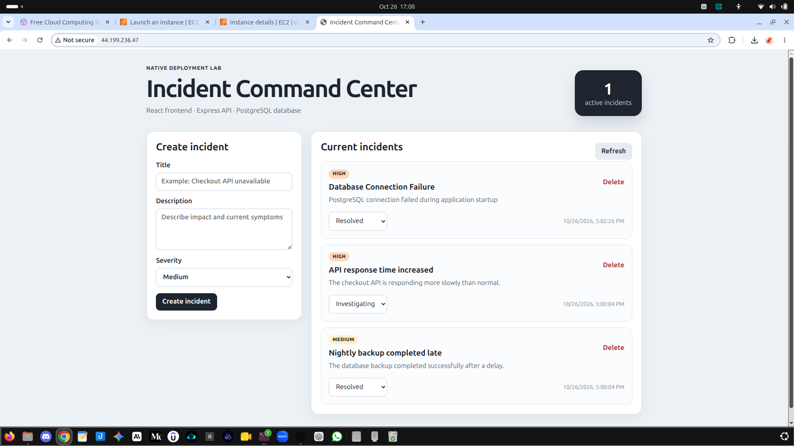

**Frontend heading updated**

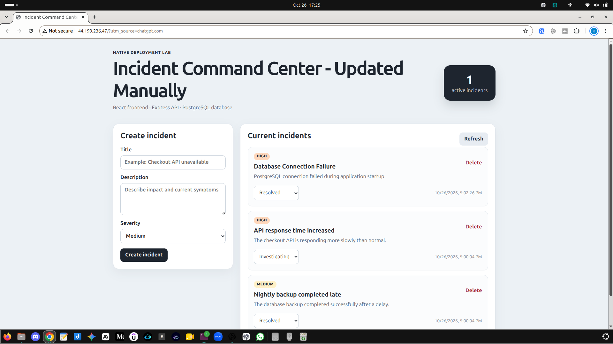

**Service verification**

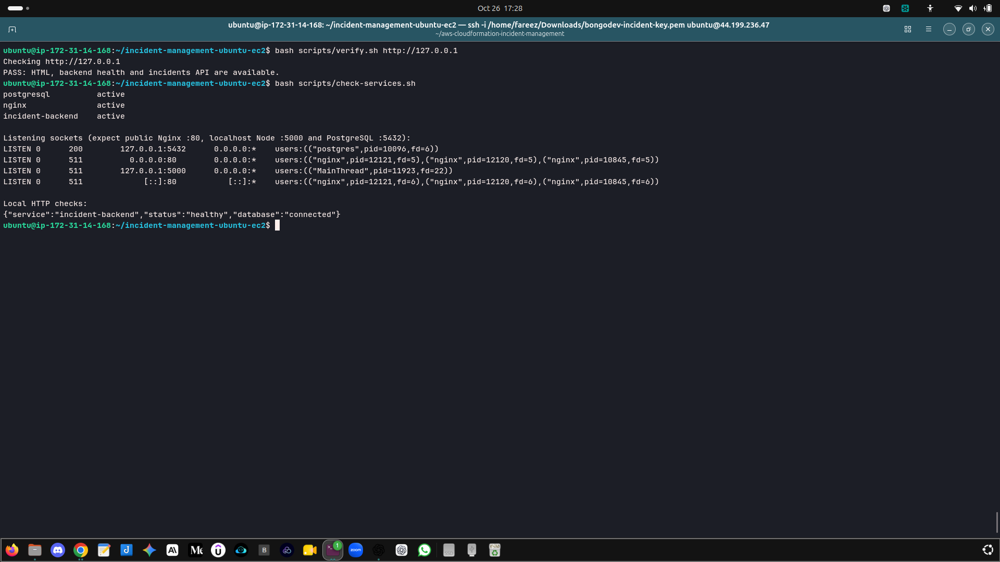

### AWS Resource Cleanup

After testing, I cleaned up the resources used for the Incident Management lab in `us-east-1`.

| Resource | Result |
|---|---|
| Running EC2 instances | 0 |
| EBS volumes | 0 |
| EBS snapshots owned by me | 0 |
| Elastic IPs | 0 |
| Active CloudFormation stacks | 0 |
| Incident Management security group | Deleted |
| Incident Management EC2 key pair | Deleted |
| Default security group | Kept |

I kept the default security group and an unrelated DevOps key pair because they were not part of this lab's cleanup.

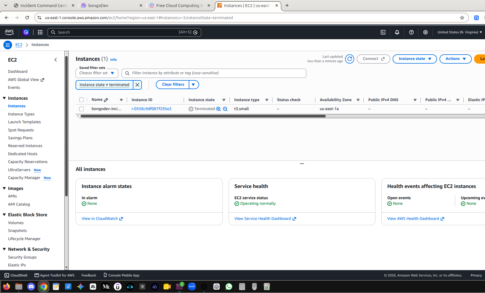

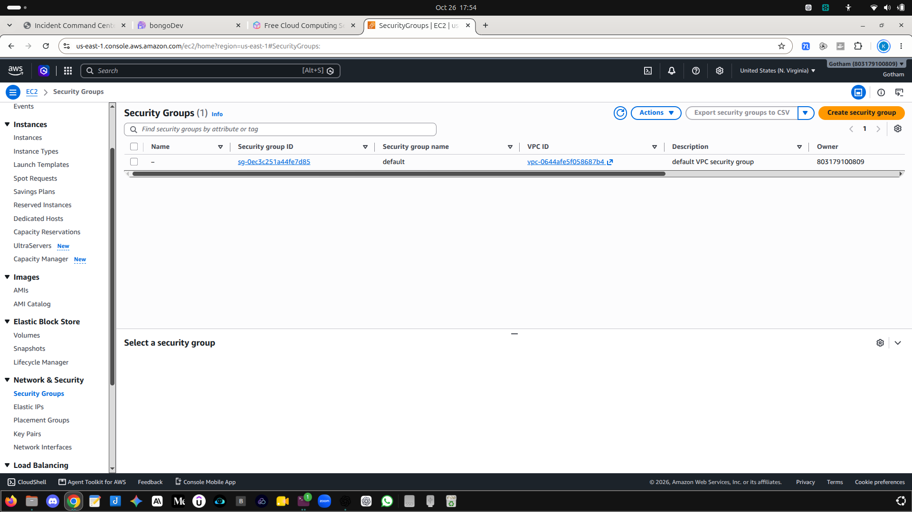

These checks document the resources listed above in `us-east-1`. They do not prove that every AWS resource in every region and service has been removed.

### What I Learned

I practiced deploying a full-stack application on Linux, configuring PostgreSQL, setting up Nginx, managing a backend with systemd, troubleshooting deployment errors, verifying application health, and cleaning up AWS resources.

---

## Repository Structure

```text
aws-cloudformation-incident-management/
├── .github/workflows/deploy.yml
├── .github/workflows/incident-management-ci.yml
├── cloudformation.yaml
├── infrastructure/cloudformation-lab/cloudformation.yaml
├── screenshots/
└── incident-management/
    ├── backend/
    ├── frontend/
    ├── deploy/
    ├── scripts/
    ├── docs/
    └── screenshots/

```

## Security

I used GitHub OIDC authentication for the CloudFormation workflow. The Incident Management app has a single administrator sign-in and protects incident API endpoints with server-side sessions. The CI workflow validates code and builds the frontend but does not deploy the app to AWS. This is still a learning demo, not a production-ready identity system: configure HTTPS, set `SESSION_COOKIE_SECURE=true`, restrict network access, and add operational controls before public use. Keep `backend/.env`, database passwords, and private keys out of Git. See `incident-management/docs/AUTHENTICATION.md` for setup and limitations.

## Summary

The CloudFormation project helped me practice infrastructure creation and automated deployment. The Incident Management project helped me practice Linux administration, application deployment, service configuration, troubleshooting, verification, and AWS cleanup.
